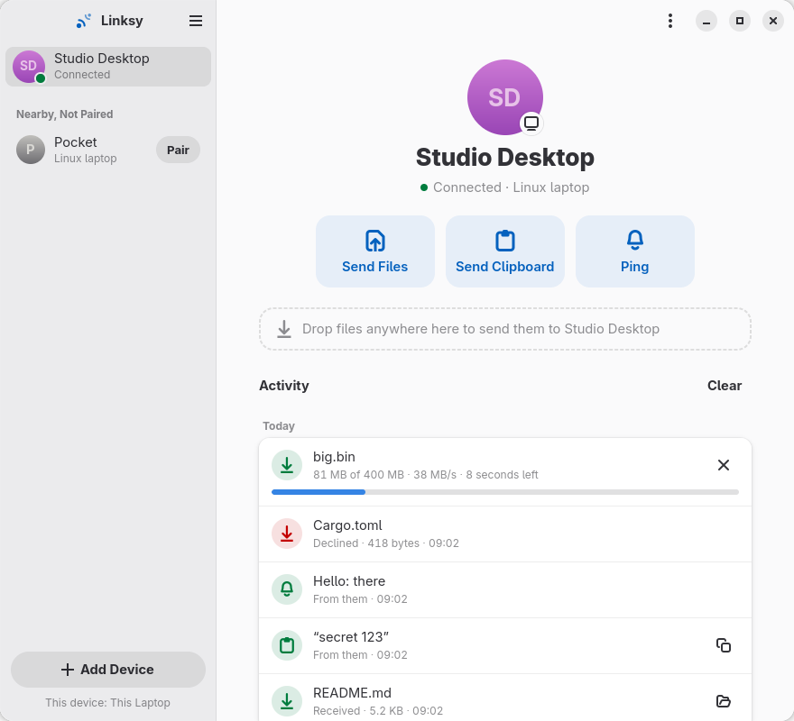

# Linksy

Your devices, connected. Share files, notifications and more between nearby devices,
directly over the local network, with no account, cloud or server.

<p align="center">
  
</p>

## Layout

| Path | What it is |
|---|---|
| `crates/linksy-core` | Device identity, discovery (mDNS), pairing, QUIC transport, file transfer. No UI. |
| `crates/linksyd` | The always-on background service. Knows which devices are nearby, receives files, shows desktop notifications. |
| `crates/linksy-ipc` | The local socket protocol between the service and its front ends. |
| `crates/linksy-cli` | `linksy`, the command-line front end. |
| `crates/linksy-gtk` | `linksy-app`, the GTK4/libadwaita app for Linux. |
| `crates/linksy-screen` | Screen capture and H.264 encoding (GStreamer, ScreenCast portal), started only while sharing. |
| `brand/` | Logo and brand assets. |
| `data/` | Desktop entry, icons, systemd user unit. |
| `docs/protocol.md` | Handoff for the Android app: product, feature status and the exact wire protocol. |

Front ends come and go; the service does the work. With no window open, Linksy is one
small process (about 6 MB on disk, 7 MB of memory, no CPU when idle).

## How it works

- **Identity.** Each device makes a self-signed certificate on first run. Its SHA-256
  fingerprint is the device id. There is no central authority.
- **Presence.** Devices advertise `_linksy._udp.local.` over mDNS and re-check every
  45 s that the devices they see are still there. That's all that happens while idle.
- **Connect on demand.** Sending something dials the device at every address known for it
  (announced ones and the last one that worked) in parallel. A connection with nothing
  going on closes after a minute. "Stay connected" in Preferences keeps links open
  instead, for the lowest latency on mains power.
- **Pairing.** Both screens show a 6-digit code derived from the encrypted session, and
  both users confirm it. A device in the middle would see a different code.
- **Transport.** QUIC (TLS 1.3, mutual authentication). Each transfer or message gets its
  own stream on the connection, so a large file never blocks a notification.
- **Transfers.** Files are streamed from disk with a BLAKE3 check per file. Interrupted
  transfers resume, and a file only appears once its checksum matches.
- **Consent.** Pairing always asks both users. Incoming files ask first, in the app or
  through a desktop notification with Accept/Decline buttons, unless "Accept From Paired
  Devices" is on.

## Install

Download the latest Linux release from
[LinkSy-mg/linksy-releases](https://github.com/LinkSy-mg/linksy-releases/releases)
(`linux-v…` tags), in the format that suits your system:

```sh
flatpak install --user linksy-0.2.1.flatpak          # any distribution
sudo apt install ./linksy_0.2.1_amd64.deb             # Ubuntu 24.10+, Debian 13+
sudo dnf install ./linksy-0.2.1-1.x86_64.rpm          # Fedora 41+
tar xzf linksy-0.2.1-linux-x86_64.tar.gz && linksy-0.2.1-linux-x86_64/install.sh  # into ~/.local
```

The .deb, .rpm and tarball need x86_64 with glibc 2.39+, GTK 4.14+ and libadwaita 1.6+. The
background service starts with your session; the Flatpak sets that up the first time it opens.

To cut a release: add the version's section to `CHANGELOG.md` and the metainfo's
`<releases>`, bump `version` in `Cargo.toml`, run `scripts/package-linux.sh` (tarball, .deb,
.rpm) and `scripts/package-flatpak.sh`, tag `vX.Y.Z` here and publish the files on this repo
and, as `linux-vX.Y.Z` (not marked latest, which belongs to the Android APKs), on
linksy-releases. Flathub builds from the tag with `packaging/flatpak/mg.diary.linksy.Linksy.yml`.

## Build

Rust stable (edition 2024). The service, CLI and core build anywhere:

```sh
cargo build --release      # linksyd + linksy
cargo test                 # unit + end-to-end tests
```

The GTK app and the screen helper need GTK ≥ 4.14, libadwaita ≥ 1.6 and GStreamer ≥ 1.22
headers:

```sh
sudo dnf install gtk4-devel libadwaita-devel gstreamer1-devel gstreamer1-plugins-base-devel   # Fedora
sudo apt install libgtk-4-dev libadwaita-1-dev libgstreamer1.0-dev libgstreamer-plugins-base1.0-dev
cargo build --release -p linksy-app -p linksy-screen
```

At run time, screen mirroring uses GStreamer plugins: `pipewiresrc` (pipewire-gstreamer),
an H.264 encoder (VA-API, x264 or OpenH264), an H.264 decoder (libav, VA-API or OpenH264)
and `gtk4paintablesink` (gstreamer1-plugin-gtk4).

Without root, a toolbox works: `toolbox create linksy-dev`, then
`toolbox run -c linksy-dev sudo dnf install -y gtk4-devel libadwaita-devel gcc`, then
build with `toolbox run -c linksy-dev cargo build -p linksy-app`.

## Run

```sh
scripts/install-local.sh   # installs to ~/.local and enables the user service
linksy-app                 # the app
linksy devices             # or the CLI
linksy pair "Other Laptop"
linksy send "Other Laptop" ~/Pictures/photo.jpg
linksy clip "Other Laptop" "some text"
linksy settings auto-accept on
```

Or run without installing: `cargo run -p linksyd` in one terminal, then
`cargo run -p linksy -- devices`.

Firewall: allow UDP 47200 (Linksy) and UDP 5353 (mDNS). On Fedora:
`sudo firewall-cmd --permanent --add-port=47200/udp --add-service=mdns && sudo firewall-cmd --reload`.

## Roadmap

- [x] Discovery, presence, pairing (code or by address), persistent identities
- [x] Connect on demand with idle close; optional stay-connected
- [x] File and folder transfer with progress, integrity check, resume
- [x] Device-to-device notifications
- [x] Background service, desktop notifications, CLI
- [x] GTK4/libadwaita app: device pages with an activity timeline, Add Device hub, Preferences
- [x] Activity history kept by the service (`linksy history`)
- [x] Clipboard sharing (text, on demand: app ⋯ menu or `linksy clip`; received text is copied via wl-copy/xclip/xsel)
- [ ] Automatic clipboard sync
- [x] "Send with Linksy" in Files (right-click → Scripts), "Open With Linksy" for files and folders
- [ ] Tray icon (GNOME has none by default)
- [ ] Android app (Flutter; see `docs/protocol.md`)
- [ ] QR-code pairing
- [ ] macOS (AppKit) and Windows (WinUI) apps
- [x] Screen mirroring between computers (View Screen; the sharer always approves)
- [x] Remote control of a mirrored screen (Take Control; asked for separately)
- [x] Sidecar: another device as a second display (virtual monitor, driven from that device)
- [x] Another device's camera as a webcam ("Linksy Camera" in PipeWire apps); the Android side is in `docs/protocol.md`

## Development aids

- `scripts/ui-scene.sh <dir>` starts two local services ("This Laptop" and "Studio Desktop")
  and pairs them. Point the app or CLI at one with `LINKSY_SOCKET=<dir>/a.sock`.
- `scripts/ui-shot.sh <socket> <out.png> [delay-ms] [light|dark] [files…]` renders the app
  on a headless Wayland compositor (weston, inside the toolbox) and saves a screenshot.
  Nothing appears on screen.

Screenshots are in `docs/screenshots/`.
