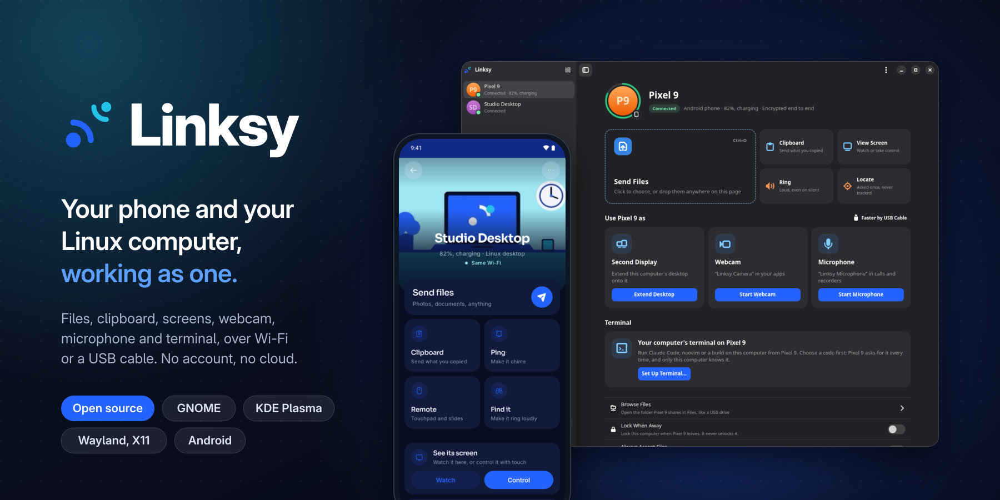
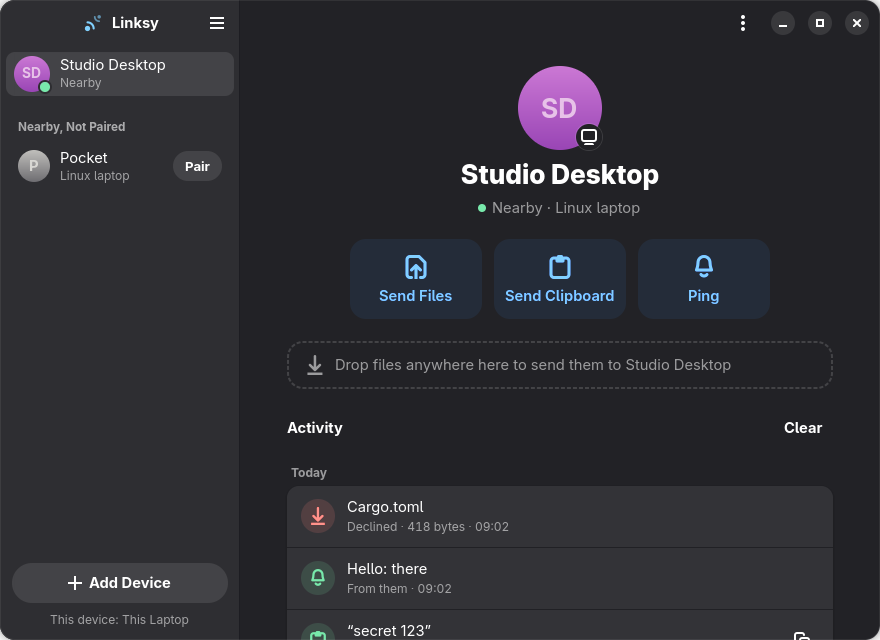
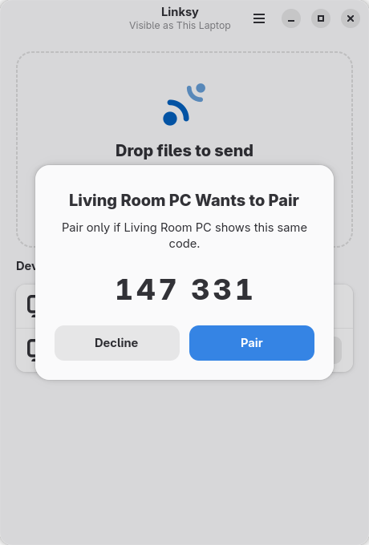
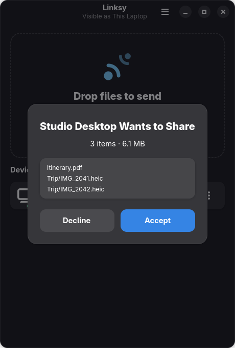

<div align="center">

  <sub>Files, clipboard, screens, webcam, microphone and terminal between your Android phone and your Linux computer. Over Wi-Fi or a USB cable, with no account, no cloud and no server.</sub>
  <br/><br/>

<p align="center">
  <a href="https://github.com/LinkSy-mg/linksy-releases/releases">
    </a>
  <a href="https://github.com/LinkSy-mg/linksy-desktop/releases/latest">
    </a>
  <a href="#install">
    </a>
  <a href="https://github.com/LinkSy-mg/linksy-releases/releases/latest">
    </a>
  <br/>
  <a href="https://github.com/LinkSy-mg/linksy-desktop/stargazers">
    </a>
  <a href="https://github.com/LinkSy-mg/linksy-desktop/issues">
    </a>
  <a href="LICENSE">
    </a>
  <a href="ROADMAP.md">
    </a>
  <a href="https://linksy.diary.mg">
    </a>
</p>

**[Install](#install)** &nbsp;·&nbsp; **[What it does](#what-it-does)** &nbsp;·&nbsp; **[Screenshots](#screenshots)** &nbsp;·&nbsp; **[How it works](#how-it-works)** &nbsp;·&nbsp; **[Build](#build-it-yourself)** &nbsp;·&nbsp; **[Contributing](CONTRIBUTING.md)**

</div>

> [!NOTE]
> This repository is the Linux side: the background service, the GTK app (GNOME and most desktops) and the Qt app (KDE Plasma). The phone needs Linksy for Android, from [linksy-releases](https://github.com/LinkSy-mg/linksy-releases/releases/latest).

---

## Install

**On the computer**, one line finds your system and desktop, asks which app you want, and installs it with one password:

```sh
curl -fsSL https://linksy.diary.mg/install.sh | sh
```

Or by hand, from [linksy-releases](https://github.com/LinkSy-mg/linksy-releases) (`linux-v…` releases; its README has the commands for each distribution):

| System | What to get |
|---|---|
| Ubuntu 24.04+, Mint 22+, Debian 13+ | `.deb`: `linksy-common` plus `linksy` (GTK) or `linksy-qt` (Plasma) |
| Fedora 41+, openSUSE Tumbleweed | `.rpm`: the same two packages |
| Arch | the AUR's `linksy` or `linksy-qt` |
| Anything else, or older | the Flatpak, or the tarball without root |

**On the phone**, install the latest `.apk` from [linksy-releases](https://github.com/LinkSy-mg/linksy-releases/releases/latest), open Linksy on both, and pair: both screens show the same code.

> [!TIP]
> Only download Linksy from these repositories, [linksy.diary.mg](https://linksy.diary.mg) or the AUR. A copy from anywhere else could be modified.

<details>
<summary>Requirements and the Flatpak</summary>

The .deb, .rpm and tarball need x86_64 with glibc 2.39+, GTK 4.14+ and libadwaita 1.5+; the
Qt app, Qt 6.8+ and KDE Frameworks 6.13+. The background service starts with your session.
The Flatpak does everything the packages do: it has host access (`org.freedesktop.Flatpak`),
so Finish Setup turns on starting at login, the webcam driver and the USB cable there too,
and the terminal for phones is the computer's own shell.
[docs/dependencies.md](docs/dependencies.md) lists everything Linksy relies on, with the
packages for each distribution, for installing it by hand.

Firewall: allow UDP 47200 (Linksy) and UDP 5353 (mDNS). Finish Setup does it for you; by hand
on Fedora and openSUSE (firewalld): `sudo firewall-cmd --permanent --add-port=47200/udp`,
`sudo firewall-cmd --permanent --add-service=mdns`, then `sudo firewall-cmd --reload`.
On openSUSE, reading the firewall's zone needs the administrator's password (polkit), so
Finish Setup doesn't look: it shows the firewall as to set up until Linksy has opened it once.

</details>

---

## What it does

- **Share.** Files and folders both ways, resumable and checked; the clipboard (text, images,
  small files), automatically where the desktop allows; notifications. "Send with Linksy" in
  Files, Dolphin and Thunar.
- **Use the phone as** a second display for the computer, a webcam ("Linksy Camera" in every
  app, with the phone's camera controls) or a microphone ("Linksy Microphone").
- **Screens.** Watch another device's screen and take control of it, each asked for
  separately. A phone on the USB cable can be controlled from the computer with no developer
  options.
- **Terminal.** The computer's shell on the phone, behind a code set on the computer, allowed
  per phone.
- **Find your phone.** Ring it, loud even on silent, or locate it on a map: asked once, never
  tracked.
- **Away from home.** Paired devices still reach each other over the internet for a week after
  they last met on the same network. Screens, files, camera and microphone stay local unless
  allowed per device.
- **Every desktop.** GNOME, KDE Plasma, Hyprland, Sway, niri, X11 desktops and more
  ([docs/desktop-support.md](docs/desktop-support.md)), a tray icon, Update Now.

With no window open, Linksy is one small process (about 20 MB of memory, no CPU when idle).

---

## Screenshots

<table>
  <tr>
    <td></td>
    <td></td>
  </tr>
  <tr>
    <td align="center"></td>
    <td align="center"></td>
  </tr>
</table>

---

## How it works

- **Identity.** Each device makes a self-signed certificate on first run. Its SHA-256
  fingerprint is the device id. There is no central authority.
- **Presence.** Devices advertise `_linksy._udp.local.` over mDNS and re-check every
  45 s that the devices they see are still there. That's all that happens while idle.
- **Connect on demand.** Sending something dials the device at every address known for it
  (announced ones and the last one that worked) in parallel. A connection with nothing
  going on closes after a minute. "Stay connected" in Preferences keeps links open
  instead, for the lowest latency on mains power.
- **Pairing.** Both screens show a 6-digit code derived from the encrypted session, and
  both users confirm it. A device in the middle would see a different code.
- **Transport.** QUIC (TLS 1.3, mutual authentication). Each transfer or message gets its
  own stream on the connection, so a large file never blocks a notification.
- **Transfers.** Files are streamed from disk with a BLAKE3 check per file. Interrupted
  transfers resume, and a file only appears once its checksum matches.
- **Consent.** Pairing always asks both users. Incoming files ask first, in the app or
  through a desktop notification with Accept/Decline buttons, unless "Accept From Paired
  Devices" is on.

Front ends come and go; the service does the work. `docs/protocol.md` is the exact wire
protocol, and the handoff for the Android app.

---

## Build it yourself

You only need this to change the code. To use Linksy, see [Install](#install).

Rust stable (edition 2024). The service, CLI and core build anywhere:

```sh
cargo build --release      # linksyd + linksy
cargo test                 # unit + end-to-end tests
```

The GTK app and the screen helper need GTK ≥ 4.14, libadwaita ≥ 1.5 and GStreamer ≥ 1.22
headers:

```sh
sudo dnf install gtk4-devel libadwaita-devel gstreamer1-devel gstreamer1-plugins-base-devel   # Fedora
sudo apt install libgtk-4-dev libadwaita-1-dev libgstreamer1.0-dev libgstreamer-plugins-base1.0-dev
sudo zypper install gtk4-devel libadwaita-devel gstreamer-devel gstreamer-plugins-base-devel   # openSUSE
cargo build --release -p linksy-app -p linksy-screen
```

At run time, screen mirroring uses GStreamer plugins: `pipewiresrc` (pipewire-gstreamer),
an H.264 encoder (VA-API, x264 or OpenH264), an H.264 decoder (libav, VA-API or OpenH264)
and `gtk4paintablesink` (gstreamer1-plugin-gtk4).

Without root, a toolbox works: `toolbox create linksy-dev`, then
`toolbox run -c linksy-dev sudo dnf install -y gtk4-devel libadwaita-devel gcc`, then
build with `toolbox run -c linksy-dev cargo build -p linksy-app`.

### The Qt app (KDE Plasma)

`linksy-qt` is a second window on the same service, in Qt 6 and Kirigami, for Plasma. It
needs Qt 6 (base and declarative), Kirigami, Kirigami Addons and KDE's desktop style, and
the `lld` linker:

```sh
sudo dnf install qt6-qtbase-devel qt6-qtdeclarative-devel kf6-kirigami kf6-kirigami-addons kf6-qqc2-desktop-style lld
QMAKE=qmake6 cargo build -p linksy-qt
```

Without root, `packaging/qt/Containerfile` is that environment in a container (its header
says how), and `scripts/qt-shot.sh` renders the app in it against two test services.

### Run

```sh
scripts/install-local.sh   # installs to ~/.local and enables the user service
linksy-app                 # the app
linksy devices             # or the CLI
linksy pair "Other Laptop"
linksy send "Other Laptop" ~/Pictures/photo.jpg
linksy clip "Other Laptop" "some text"
linksy settings auto-accept on
```

Or run without installing: `cargo run -p linksyd` in one terminal, then
`cargo run -p linksy -- devices`.

### Development aids

- `scripts/ui-scene.sh <dir>` starts two local services ("This Laptop" and "Studio Desktop")
  and pairs them. Point the app or CLI at one with `LINKSY_SOCKET=<dir>/a.sock`.
- `scripts/ui-shot.sh <socket> <out.png> [delay-ms] [light|dark] [files…]` renders the app
  on a headless Wayland compositor (weston, inside the toolbox) and saves a screenshot.
  Nothing appears on screen.

Screenshots are in `docs/screenshots/`.

### Layout

| Path | What it is |
|---|---|
| `crates/linksy-core` | Device identity, discovery (mDNS), pairing, QUIC transport, file transfer. No UI. |
| `crates/linksyd` | The always-on background service. Knows which devices are nearby, receives files, shows desktop notifications. |
| `crates/linksy-ipc` | The local socket protocol between the service and its front ends. |
| `crates/linksy-cli` | `linksy`, the command-line front end. |
| `crates/linksy-gtk` | `linksy-app`, the GTK4/libadwaita app for Linux. |
| `crates/linksy-qt` | `linksy-qt`, the Qt 6/Kirigami app for KDE Plasma. |
| `crates/linksy-screen` | Screens, cameras and microphones, started only while sharing: capture and H.264 encoding (GStreamer: the ScreenCast portal, or the X display on X11), and input (the RemoteDesktop portal, XTest on X11, the virtual pointer and keyboard on Hyprland and Sway). |
| `crates/linksy-setup` | Finish Setup: what each feature needs, and adding it with one password. Shared by both apps. |
| `crates/linksy-host` | Programs and files on the computer, from the Flatpak too, and pkexec with Linksy's own password prompt. |
| `crates/linksy-upgrade` | Update Now and `linksy upgrade`. |
| `crates/linksy-i18n`, `linksy-news`, `linksy-logs` | Translations, What's New, and `logs.txt` for bug reports. |
| `brand/` | Logo and brand assets. |
| `data/` | Desktop entry, icons, systemd user unit. |
| `docs/protocol.md` | Handoff for the Android app: product, feature status and the exact wire protocol. |

### Releasing

Add the version's section to `CHANGELOG.md` and the metainfo's `<releases>`, bump `version`
in `Cargo.toml`, commit, and run `scripts/publish-release.sh`. It tags `vX.Y.Z` and pushes
it; GitHub (the Packages workflow) builds every package and the Flatpak, installs the
packages on every supported distribution, and when all of that passes publishes the release
here and, as `linux-vX.Y.Z` (not marked latest, which belongs to the Android APKs), on
linksy-releases. Flathub builds from the tag with
`packaging/flatpak/mg.diary.linksy.Linksy.yml`. `scripts/package-linux.sh` and
`scripts/package-flatpak.sh` still build everything locally, to try a package.

---

## Roadmap

What's next is in [ROADMAP.md](ROADMAP.md).

<details>
<summary>Done so far</summary>

- [x] Discovery, presence, pairing (code or by address), persistent identities
- [x] Connect on demand with idle close; optional stay-connected
- [x] File and folder transfer with progress, integrity check, resume
- [x] Device-to-device notifications
- [x] Background service, desktop notifications, CLI
- [x] GTK4/libadwaita app: device pages with an activity timeline, Add Device hub, Preferences
- [x] Activity history kept by the service (`linksy history`)
- [x] Clipboard sharing (text, images and single files up to 10 MB, on demand: app ⋯ menu or `linksy clip`; received content is copied via wl-copy/xclip/xsel)
- [x] Automatic clipboard sync, computer to phone, where the desktop allows watching the clipboard (KDE, wlroots; not GNOME)
- [x] "Send with Linksy" in Files (right-click; with nautilus-python, else → Scripts), Dolphin and Thunar (Send To), "Open With Linksy" for files and folders
- [x] Away from home: paired devices reach each other over the internet (iroh, Linksy's relay), for a week after they last met on the same network; screens, files, camera and microphone stay local unless allowed per device
- [x] Locate a phone (`linksy locate`), asked once, never tracked
- [x] Terminal from the phone (`linksy terminal`): a shell here behind a code set on this computer, allowed per phone
- [x] Finish Setup: everything a feature needs (packages, camera device, USB, firewall, autostart) in one go
- [x] QR-code pairing
- [x] Android app (Flutter, separate repository; see `docs/protocol.md`)
- [x] Tray icon, from the service (GNOME shows it with the AppIndicator extension)
- [x] Qt 6 app for KDE Plasma
- [x] Every desktop: X11 (screens and control without a portal), Hyprland and Sway (control through the compositor's virtual pointer and keyboard), niri, and Linksy's own password prompt where no polkit agent runs ([docs/desktop-support.md](docs/desktop-support.md))
- [x] A Flatpak that does everything the packages do
- [x] Update Now and `linksy upgrade`: the new version checked against the release's checksums and installed with one password
- [x] Screen mirroring between computers (View Screen; the sharer always approves)
- [x] Remote control of a mirrored screen (Take Control; asked for separately)
- [x] Sidecar: another device as a second display (virtual monitor, driven from that device)
- [x] Another device's camera as a webcam ("Linksy Camera" in PipeWire apps), with its camera controls on the computer; the Android side is in `docs/protocol.md`
- [x] Another device's microphone as a microphone ("Linksy Microphone", `linksy mic`)
- [x] Phones over a USB cable (Android Open Accessory, no developer options): lower latency, no network needed

</details>

---

## Contributing

Bug reports, translations and pull requests are welcome: see [CONTRIBUTING.md](CONTRIBUTING.md).
If Linksy helps you, a star or telling a friend helps it reach more people.

## License

Linksy is open source under the [GNU Affero General Public License v3.0 or later](LICENSE). The open-source
libraries it builds in are credited, with their licenses, in
[THIRD-PARTY-NOTICES](THIRD-PARTY-NOTICES); regenerate it with
`scripts/third-party-notices.py > THIRD-PARTY-NOTICES` after `Cargo.lock` changes.
